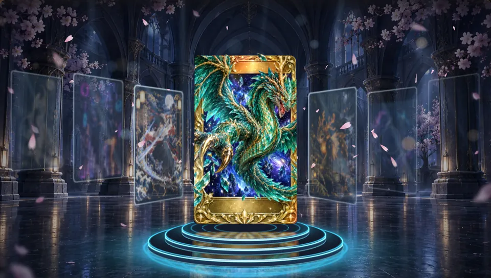
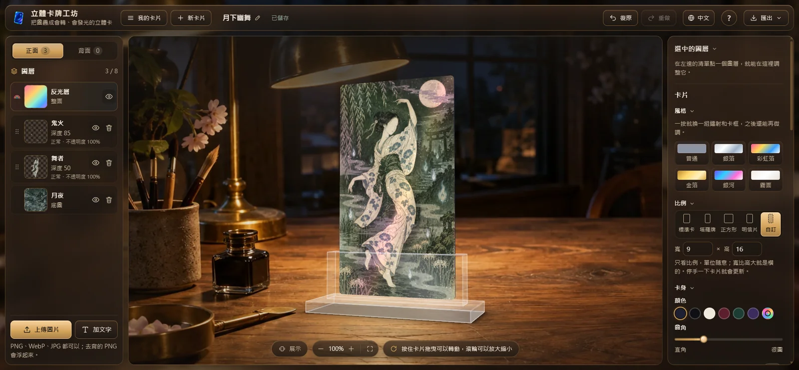
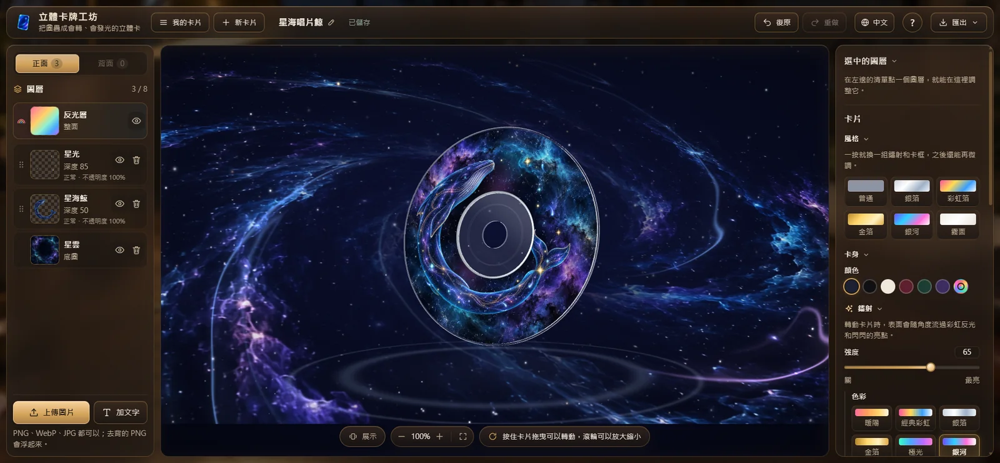
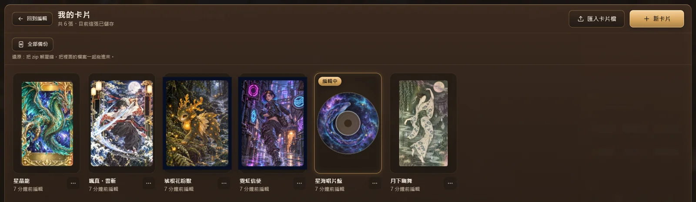

# HoloCard-Studio（立體卡牌工坊）

上傳幾張圖，疊成一張可以拖著轉、有立體深度、會隨角度反光的卡片；自動保存，並能匯出卡片檔（`.holocard`）、PNG、轉動影片（MP4／WebM）與 GIF。**全部在你的電腦上處理，圖片不會上傳到任何地方**，工坊執行時也不連網路。



## 可以做什麼

- **疊圖成立體卡**：上傳去背的 PNG 就會浮起來，自動排前後；在卡上直接拖曳、拉四角縮放。
- **讓角色衝出卡框**：開「衝出卡片」，角色的頭和翅膀可以超出卡片邊緣，轉動時一樣有立體感。
- **鐳射與反光層**：七種鐳射色彩（可自訂）、閃星；每一面有一個「反光層」決定哪裡是亮面、哪裡是霧面。
- **混合模式**：加深、發光、強光、疊色、柔光、換色——黑底的光效、白底的線稿不用去背也能疊。
- **文字**：四種免費字型、描邊與印章樣式、直排。
- **卡框**：金屬卡框，簡約或雕花邊角；景深陰影。
- **舞台**：全息光環、展示廳、魔法陣、水鏡、星雲、工作桌、關閉，共七種選擇；新卡片預設放在工作桌的壓克力展示架上。
- **背景圖／前景圖**：每張卡可以放自己的背景圖與前景圖，調整位置與大小；匯出時可以選擇「畫上背景」。
- **光碟**：圓形印刷面可以疊圖，背面是隨轉動流過彩虹的銀色資料面。
- **透明卡套**：替卡片套上透明塑膠殼，轉動時邊緣會反光。
- **變身圖**：替圖層加上另一張圖，左右轉卡就會換圖，像會動的光柵卡。
- **動態特效**：在圖層形狀裡加上火焰、電光或水波，調整顏色、強度與速度。
- **匯出**：卡片檔（之後可以再編輯、給別人匯入）、PNG（可透明）、轉一圈或左右擺動的影片（4～12 秒、可以配音樂）與 GIF（可選大小、先估檔案多大）。
- **我的卡片**：自動保存、卡片庫、複製、改名；六張原創範例卡。
- **全部備份**：把卡片庫打包成一個 zip；還原時解壓縮，再把裡面的卡片檔一起拖進工坊。
- **介面語言**：繁體中文、English、日本語、한국어；首次照瀏覽器語言選擇，也能用頁首的地球按鈕切換。
- **AI 自動去背、一張圖變立體**（選用）：在你的電腦上跑，不上傳圖片；第一次要先下載模型（見下面）。

## 畫面

**工作桌舞台**：卡片插在壓克力展示架上；左邊是圖層，右邊調外觀。



**星雲舞台＋光碟**：光碟的印刷面一樣可以疊圖、有鐳射。



**我的卡片**：自動保存的卡片庫，可以一次全部備份。



## 開始用

**雙擊 `main.bat`**——第一次會自動安裝需要的套件，準備好會自動打開瀏覽器；工坊已經在執行時直接打開瀏覽器；要結束就關掉那個黑色視窗。（需要先安裝 Node.js 22 以上；只做桌機瀏覽器，建議 Chrome 或 Edge。）

### 需要先裝的

- **Node.js 22 以上**（https://nodejs.org/）：用來在你的電腦上開工坊。
- **桌機版 Chrome 或 Edge**：工坊是在瀏覽器裡用的網頁。

### 會自動安裝的套件

第一次雙擊 `main.bat`（或手動執行 `npm install`）時從 npm 下載，只要一次；版本鎖在 `package-lock.json`。

工坊執行時會用到的（打包進工坊）：

| 套件 | 版本 | 用途 |
|---|---|---|
| `three` | 0.186.1 | 3D 繪圖引擎：畫立體卡片、鐳射反光和舞台（優先用 WebGPU，瀏覽器不支援時自動改用 WebGL2） |
| `fflate` | 0.8.3 | zip 壓縮與解壓：讀寫卡片檔（`.holocard`）、全部備份 |
| `gifenc` | 1.0.3 | 匯出 GIF：把顏色整理成 256 色再編碼成動圖 |
| `onnxruntime-web` | 1.30.0 | 在瀏覽器裡跑 AI 模型（自動去背、一張圖變立體）；沒下載模型時用不到 |

只有開發時用的（不會打包進工坊）：

| 套件 | 版本 | 用途 |
|---|---|---|
| `vite` | 8.3.2 | 開發伺服器（`npm run dev`）與打包（`npm run build`） |
| `typescript` | 5.9.3 | 檢查程式有沒有寫錯型別（`npm run typecheck`） |
| `vitest` | 5.0.3 | 自動測試（`npm test`） |
| `fake-indexeddb` | 6.2.5 | 測試時假裝成瀏覽器的存檔資料庫 |
| `@types/node`、`@types/three` | 22.20.5、0.186.0 | 給 TypeScript 看的型別說明，不會執行 |

這些套件自己還會帶幾個小套件（例如 `onnxruntime-web` 用的 `protobufjs`）；完整清單與授權見 `THIRD_PARTY_NOTICES.md`。

手動啟動：

```bash
npm install
npm run dev
```

然後用瀏覽器開 `http://127.0.0.1:5190/`。

### AI 功能（選用，只要一次）

AI 自動去背與「一張圖變立體」用的模型約 275 MB，沒有放進專案。要用的話，關掉工坊，雙擊 **`下載AI模型.bat`**（英文訊息版：`download-ai-models.bat`；或執行 `npm run fetch-models`）。下載完會檢查檔案是不是完整、正確；之後工坊在你的電腦上跑模型，不連網路。

| 模型 | 大小 | 用途 | 授權 |
|---|---|---|---|
| IS-Net anime（`isnet-anime.onnx`） | 約 176 MB | 自動去背：把主角從背景剪下來 | Apache-2.0 |
| Depth Anything V2 Small（`depth-anything-v2-small.onnx`） | 約 99 MB | 一張圖變立體：估計畫面裡的遠近，拆成幾層 | Apache-2.0 |

模型的出處與授權細節見 `docs/refs/README.md` §3.1 與 `THIRD_PARTY_NOTICES.md`。

## 用 AI 生圖做分層卡

想自己做圖：`docs/prompt-guide.md` 整理了好疊的分層圖提示詞寫法；`public/samples/prompts/` 是六張範例卡實際用的提示詞。

## 給開發者

- 規格：`docs/spec-v0.1.md`；畫面：`DESIGN.md`；結構與資料：`ARCHITECTURE.md`、`SCHEMA.md`（卡片檔 `.holocard` 格式在 SCHEMA §4）
- 測試：`npm test`、`npm run typecheck`、`npm run build`
- 授權：MIT（`LICENSE`），範例卡與介面圖也一樣；第三方程式、字型、模型的授權見 `THIRD_PARTY_NOTICES.md`
